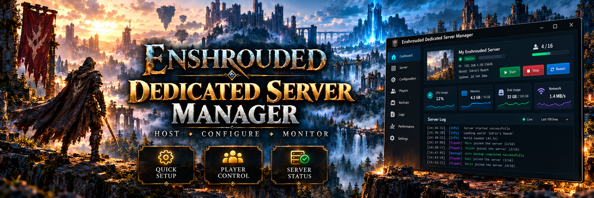

# Enshrouded Dedicated Server Manager: Private Config Tool for Windows 11

    

---

Enshrouded Dedicated Server Manager is a Windows companion project for configuring and maintaining private Enshrouded dedicated servers. It organizes server management around profile handling, status monitoring, world backups, and a console-driven workflow, with packaged Windows releases distributed alongside the project documentation. The project is community-maintained, provided as a themed utility package, and is not affiliated with Keen Games.

## Features

- **Server Profiles:** Create, store, and switch between named configuration sets so multiple private dedicated server instances can be maintained from a single desktop interface, with profile-specific parameters isolated from one another.

- **Status Dashboard:** Consolidated view of the managed server instance, surfacing runtime state information and configuration summary data for at-a-glance verification before and during operation.

- **World Backups:** Backup workflow area for safeguarding world data associated with the managed dedicated server, intended to preserve state prior to configuration changes or routine maintenance.

- **Configuration Management:** Centralized handling of private dedicated server settings, supporting structured editing and persistence of server parameters through the desktop application.

- **Windows Distribution Package:** Delivered as a ZIP archive containing the primary executable and accompanying bundled files, structured for extraction into a self-contained working directory.

- **Self-Contained Desktop Tooling:** Operates as a local Windows companion utility, with all management functionality accessed through the packaged executable rather than external services.

- **Documentation-Aligned Workflow:** Features are organized around the configure-and-maintain lifecycle for private servers, with the bundled documentation describing the intended sequence of obtaining, unpacking, and operating the release package.

## How It Works

Enshrouded Dedicated Server Manager operates on a profile-based model that separates configuration, runtime control, and backup operations into distinct workflow stages. Each stage is driven by local files and explicit user actions, so no background service or remote account is required to manage a private server.

- **Profile-driven configuration:** Server profiles are stored as discrete configuration sets. Selecting a profile loads its associated parameters into the active workspace, allowing multiple private servers or setup variants to coexist without overwriting one another.
- **Config file resolution:** On launch, the manager resolves the expected server configuration and data paths from the selected profile. Invalid or missing paths are surfaced before any session begins, preventing partial writes against an unverified directory.
- **Status polling:** The status dashboard polls the local server process and its associated endpoints on a fixed interval. Process presence, listening state, and reported health are aggregated into a single view, with transitions surfaced as discrete state changes rather than raw log noise.
- **Session tracking:** Player session data is derived from the server's own output and connection records. The manager parses these records into a structured session list, mapping connections to timestamps and durations without modifying the underlying server files.
- **Log tailing:** A bounded log viewer follows the active server log, applying a fixed-size ring buffer to keep memory use predictable during long sessions. Filtering and severity highlighting are applied client-side against the buffered lines.
- **Backup snapshots:** World backups are created as timestamped snapshots of the configured world directory. Each snapshot is written to a staging path and validated for completeness before being committed, so an interrupted backup does not replace a known-good archive.
- **Restart orchestration:** Restart operations are sequenced as a controlled shutdown, a bounded wait for process exit, and a relaunch using the active profile. The wait is capped by a configurable timeout, and a failed exit is reported rather than followed by a forced relaunch.
- **Local-only execution:** All operations run against paths on the local machine. The manager does not transmit configuration, logs, or world data, and it holds no credentials beyond what the local server configuration already requires.

Because each stage depends on the previous one, the recommended operating order is to confirm the profile and resolved paths, verify status and sessions, then perform backups before any configuration change or restart.

## Requirements

The following minimum environment is required to run Enshrouded Dedicated Server Manager:

- **Operating System:** Windows 10 or Windows 11 (64-bit editions). Older Windows versions are not supported.
- **Runtime:** A current, fully patched Windows installation with the standard system libraries present. The packaged executable is distributed as a self-contained Windows build; no separate language runtime installation is expected.
- **Storage:** Sufficient free disk space for the application bundle plus an additional allocation for server configuration files, world backups, and logs. Backup storage should be sized according to the number and frequency of retained world snapshots.
- **Memory:** Adequate RAM for the manager utility alongside any concurrently running Enshrouded dedicated server process. Server memory demand scales with player count and world complexity and should be provisioned independently of the manager.
- **Permissions:** A user account with read and write access to the directory containing the extracted application files, as well as to the server installation and configuration paths the manager is intended to administer. Administrative elevation may be required depending on where the server files reside.
- **Network:** Local network access to the host machine for server status and session monitoring. External connectivity requirements are governed by the dedicated server configuration, not by the manager itself.
- **Prerequisites:** A working Enshrouded dedicated server installation with valid configuration files. The manager is a companion utility and does not supply, host, or license the game server software.
- **Packaging Integrity:** The complete distribution archive must be extracted as a unit. Bundled directories, libraries, and configuration files must remain together in their original relative layout; partial extraction or selective file removal will prevent normal operation.

Feature availability assumes the above baseline. Configurations outside these parameters are unsupported and may produce incomplete or unpredictable behavior.

## Compatibility

The manager targets Windows desktop environments and is distributed as a portable ZIP package containing a Windows executable and its supporting files. It is intended for use alongside a locally hosted or privately operated Enshrouded dedicated server on the same machine or within the same network.

- **Operating System:** Windows 10 and Windows 11 (64-bit) are the supported desktop platforms.
- **Runtime:** The application runs as a standalone Windows executable; no separate language runtime or package manager installation is required beyond the bundled files.
- **Server Target:** Designed for private Enshrouded dedicated server configuration and maintenance workflows.
- **Network Scope:** Intended for local and private-network server management; it is not a matchmaking or public server browser service.
- **File Layout:** All bundled directories, DLLs, and configuration files must remain together in the extracted folder for the application to function correctly.
- **Independence:** This is a community companion utility and is not affiliated with, endorsed by, or sponsored by Keen Games. Product names are referenced solely to describe compatibility with the Enshrouded dedicated server.

Compatibility is limited to the documented Windows distribution of this project. Behavior on other operating systems, modified server builds, or repackaged executables is not covered by this project's documentation.

## FAQ

**Is this an official Enshrouded or Keen Games product?** No. Enshrouded Dedicated Server Manager is an independent, community-maintained companion project. It is not affiliated with, endorsed by, or sponsored by Keen Games, and it should not be treated as an official server administration tool.

**What exactly does the manager configure?** The manager is scoped to private dedicated server configuration on Windows. Its documented workflow areas cover server profiles, a status dashboard, world backups, and the supporting Windows distribution package. Configuration files and server data remain on the local machine and are edited through the application's own interface rather than through external tooling.

**Is the executable's behavior verified?** The packaged runtime has not been independently audited within the source distribution. Treat feature descriptions as documented intent, confirm the build and file provenance before running anything, and validate behavior against your own server setup before relying on it.

**Which Windows versions are supported?** The project targets Windows desktop environments, with documentation oriented toward Windows 10 and Windows 11. Server hosts running older or non-standard Windows configurations should verify compatibility with their specific build before deployment.

**Does the manager require a live internet connection?** No. The manager operates as a local desktop utility for private server configuration. Network access is only relevant to the Enshrouded server itself and to obtaining the packaged release; the configuration workflow does not depend on external services.

**Can I run it alongside an existing server installation?** Yes, provided you keep an independent backup of all game data and server configuration before making changes. The manager works against local files, so isolating a copy of your server directory for testing is recommended before applying changes to a production instance.

**How are world backups handled?** Backups are a first-class workflow area. The manager is intended to let you capture and retain world state independently of the live server, which lets you restore a known-good snapshot after a misconfiguration or a failed update. Always confirm that a backup completed successfully before proceeding with destructive operations.

**Does renaming the executable change its behavior?** No. Executable filenames are labels only and do not alter program functionality or unlock undocumented features. Confirm the build matches the documented feature set rather than relying on file naming.

**What should I check if a workflow area appears non-functional?** Verify that the complete distribution was extracted with all bundled directories intact, confirm the build version against the documentation, and ensure the target server files are accessible with appropriate permissions. If behavior still diverges from the documentation, treat the discrepancy as a build issue rather than a configuration error.

**Is the manager suitable for multi-server or remote administration?** The project is scoped to private dedicated server configuration on a local Windows host. Remote orchestration and multi-tenant management are outside its documented scope, so environments requiring centralized control should look to dedicated server management platforms instead.

**How is licensing handled?** Project-authored documentation and original repository metadata are offered under the MIT License to the extent the owner holds the rights to license them. Bundled binaries, third-party components, and game assets retain their own applicable licenses and are not automatically covered.

## Disclaimer & License

This project is an independent, community-maintained Windows companion utility for private Enshrouded dedicated server configuration and is not affiliated with, endorsed by, sponsored by, or otherwise associated with Keen Games. "Enshrouded" and related product names are referenced solely to describe compatibility and intended use. All trademarks remain the property of their respective owners.

The software is provided "as is," without warranty of any kind, express or implied, including but not limited to warranties of merchantability, fitness for a particular purpose, and non-infringement. Server configuration, world data, and save files are user-controlled assets; you are solely responsible for maintaining independent backups and for verifying that any modifications are made only to data you are authorized to access and alter. The authors and contributors accept no liability for data loss, server downtime, configuration corruption, account or service restrictions, or any other damages arising from the use or misuse of this project.

Distribution is provided as a packaged Windows release consisting of an executable and accompanying bundled files. Because runtime behavior can vary across environments and builds, users are expected to review file provenance, publisher information, and security scan results before execution, and to run the software only in environments where they accept the associated risk. Feature descriptions and documentation reflect intended workflow and are not a guarantee of behavior in any specific build.

Project-authored documentation, original repository metadata, and other original materials created specifically for this project are offered under the MIT License, to the extent the project owner holds the right to license them. This permissive coverage does not extend to bundled executables, dynamically linked libraries, third-party components, source archives, or any game assets, each of which retains its own applicable license terms and must be used in accordance with those terms. No separate standalone license file is bundled with this distribution; where an MIT License grant applies, it applies only to the original project-authored materials described above. Redistribution of the packaged release, in whole or in part, must preserve this disclaimer and must not imply official status or endorsement.

